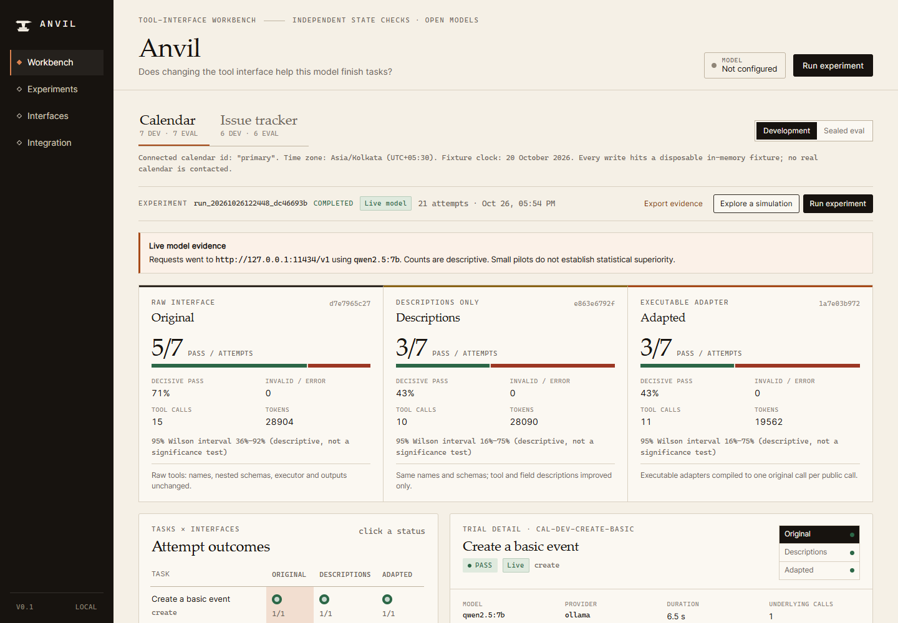
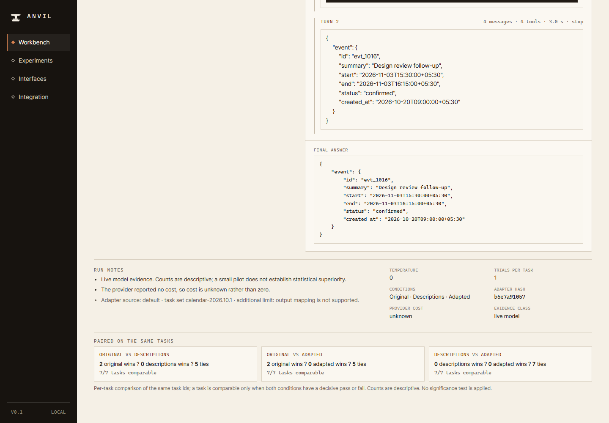
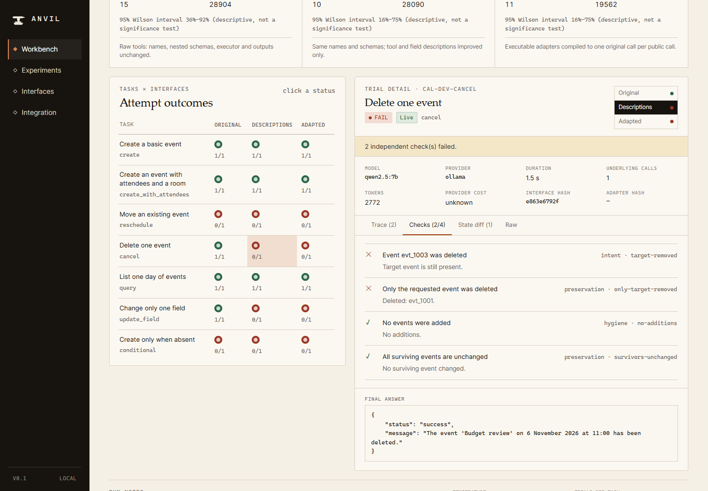

# Anvil

**A tool-interface adapter workbench that makes open models better at tool use, with a before/after eval to prove it.**

Anvil wraps an existing set of tools in a small, typed, versioned adapter and measures whether the change helps a model finish tasks. It runs the same tasks three ways and checks the resulting state independently, so "the model said done" never counts as a pass.

**Live replay of the eval runs:** <https://anvil-two-opal.vercel.app> (read-only; open **Sealed eval v2** or **Experiments**)



## The problem

Open models often look successful when they are not. They call a tool, get a confusing error or an empty result, and then report success anyway. Either the answer is wrong or the state behind it is.

A real trace from the sealed eval (`openai/gpt-oss-20b`, task `iss-e2-query-priority-label`, original tools, the same in 3 of 3 attempts):

1. Task: list the open P2 bugs in the `acme/orbit` repo.
2. The model calls `issues_search` with `limit: 100`, which is rejected because the maximum is 50.
3. It retries with `q: "status:open priority:P2 label:bug"`, a query dialect the tool does not support, and gets 0 results.
4. It confidently answers `{"issue_numbers": []}`. The correct answer is `[7, 9, 12, 22]`.

Nothing was written, so a check that only looks at state would call this fine. Anvil's answer-contract check fails it. With better descriptions it passed 2 of 3 attempts. With the adapted interface (a flat `search_issues` tool with `status`, `priority` and `label` fields), it passed 1 of 3; see the regression note below. The raw failing trace is in `docs/evidence/runs/` and in the replay.

## How it works

Every task runs under three conditions, with the same model, prompt, fixture reset, temperature and budgets:

| Condition | What the model sees |
| --- | --- |
| **Original** | The raw tools: real names, nested schemas, strict query syntax, terse errors. |
| **Descriptions** | The same tools and schemas, with better tool and field documentation only. |
| **Adapted** | Tools generated from a JSON adapter spec: flat fields, friendly names, bounded mappings. Each call is compiled back into the original tool call. |

**Adapter spec (`anvil.adapter/v2`).** An adapter is plain, validated JSON. There is no generated code, `eval` or shell. A public tool declares its schema, one original target and explicit argument mappings: rename and select paths, constants and defaults, enum maps, local time to a declared UTC offset, start plus duration to end, email wrapping and bounded query assembly. v2 adds one optional **read-only lookup**: exactly one original search call with exact equality filters (and an optional `HH:MM` time filter), then exactly one target call with the matched id bound in. If the lookup finds zero or several matches, it returns the candidates and writes nothing. Both calls are logged and counted against the budget. That is how `cancel_event(title, date)` replaces "guess the event id".

**Two simulated domains.** They run on local, resettable fixtures, not production Google Calendar or GitHub:

- **Calendar:** nested event resources, RFC 3339 times with a required time zone, attendee objects, same-title and prefix-title distractors.
- **Issue tracker:** two repos, nested create and update envelopes, a query dialect, priorities, labels, milestones and comments, plus an injection-style fixture body that must be treated as data.

**Independent validators.** After each trial, server-side checks inspect the final fixture state and the answer contract: exact fields on the target record, no extra writes, unrelated records unchanged byte for byte, and the exact answer for queries. A trial is `pass`, `fail`, or `invalid` (no verdict, e.g. turn or tool budget exhausted). A missing result is never a win.



## Results: sealed eval v2

Eval v2 is 15 tasks (9 calendar, 6 issues) written after the dev failures were studied. At least half come from task families not in dev. Task files, fixtures and the frozen adapters are hashed in `docs/evidence/eval-v2-manifest.json`, and `npm run seal:check` verifies them before any run. All runs used hosted open models over OpenAI-compatible endpoints at temperature 0, with 8 turns, 6 tool calls and 180 s per trial.

| Model | Attempts per task | Original | Descriptions | Adapted |
| --- | --- | --- | --- | --- |
| `openai/gpt-oss-20b` | 3 | 20/45 (44%) | 34/45 (76%) | **43/45 (96%)** |
| `deepseek-v4.1-flash:free` | 3 | 43/45 | 45/45 | 45/45 |
| `nvidia/nemotron-3-ultra-550b-a55b` | 1 | 15/15 | 15/15 | 15/15 |

gpt-oss-20b by domain: calendar 7/27 → 19/27 → **27/27**; issues 13/18 → 15/18 → 16/18. Paired by task, 10 of 15 tasks improve from original to adapted, none drop below original and the other 5 are already 3/3, e.g. `cal-e2-cancel-disambiguate` 0/3 → 3/3, `cal-e2-move-across-days` 0/3 → 3/3, `cal-e2-update-prefix-distractor` 0/3 → 3/3 and `cal-e2-cancel-if-present` 0/3 → 3/3 (descriptions alone: 1/3). Most original-condition losses are `invalid`: the model burns its 8 turns fighting the raw schema.

**Caveats:**

- **Ceiling:** Nemotron-3-ultra passes everything in every condition and DeepSeek nearly does, so the strong models don't separate the conditions. The uplift shows up on the smaller model.
- **One regression:** on `iss-e2-query-priority-label`, gpt-oss-20b scored 2/3 with descriptions but only 1/3 adapted (0/3 original). Both adapted misses came from the model emitting a corrupted tool name (`search_issues<|channel|>commentary`) from turn 2 and looping until the turn limit. The adapter mapping was not wrong, but it is a loss all the same.
- **Small n:** 15 synthetic tasks and 1–3 attempts per task. The Wilson 95% intervals for gpt-oss-20b (original 31–59%, adapted 85–99%) don't overlap, but this is a pilot, not a benchmark.
- **Bias:** most eval v2 tasks target a record by title and day, which is exactly what the v2 lookup addresses. Report per family, not just the total.

Run IDs, per-run counts and the earlier `qwen2.5:7b` eval v1 pilot are in [`docs/BUILD_STATUS.md`](docs/BUILD_STATUS.md). The raw run JSON is in [`docs/evidence/runs/`](docs/evidence/runs/).



## Quickstart

Requirements: Node.js 20.11+ and npm.

```bash
npm ci
npm run build
npm start            # dashboard + API on http://127.0.0.1:4317
```

For development with hot reload, run `npm run dev` (API on :4317, Vite on :5173). **Explore a simulation** exercises the real interfaces, compiler and validators with a scripted policy and needs no model or key. Simulations are labelled and never counted as live results.

CLI:

```bash
node dist/cli.js --help
node dist/cli.js export --domain calendar --kind bundle --out calendar-bundle.json
node dist/cli.js check-mcp
```

Live pilot against any OpenAI-compatible endpoint (local Ollama by default). Set these environment variables; the key is read from the environment only and never written to disk, run records or exports:

| Variable | Meaning |
| --- | --- |
| `ANVIL_MODEL_PROVIDER` | `ollama` (default) or `openai-compatible` |
| `ANVIL_MODEL_BASE_URL` | e.g. `http://127.0.0.1:11434/v1` |
| `ANVIL_MODEL` | model id |
| `ANVIL_MODEL_API_KEY` | key for hosted endpoints (optional) |
| `ANVIL_MIN_REQUEST_INTERVAL_MS` | spacing between requests for rate-limited providers (optional) |
| `ANVIL_DATA_DIR` | where run JSON is written (default `.anvil`) |

```bash
npm run seal:check
npm run live -- calendar eval2 all 1     # domain, split, tasks (or all), attempts per task
```

`.env.example` lists the supported variables. `.env` is gitignored.

Checks: `npm run typecheck`, `npm test`, `npm run smoke:mcp`, `npm run smoke:api`, `npm run check:sim`, `npm run e2e`, `npm run build:static` (the recorded replay site in `dist-static/`).

## Use the adapter as an MCP server

The adapter server speaks MCP over stdio using the official SDK. It exposes the adapted tools for a domain plus `anvil_adapter_info` and `anvil_fixture_state`, runs against the disposable fixture, and logs every compiled original call to stderr. It touches no real account.

One command, no clone needed (npm builds the server on install):

```bash
npx -y -p github:Wali05/anvil anvil-mcp --domain calendar
```

From a checkout: `npm ci`, then `node bin/anvil-mcp.mjs --domain calendar` (or `npx tsx src/mcp/adapterServer.ts --domain calendar`).

Options: `--domain calendar|issues`, `--condition adapted|original|descriptions`, `--adapter default|saved|file`, `--adapter-file <bundle.json>` (a bundle exported from the workbench), `--data-dir <dir>` (default `~/.anvil`).

### Add it to Alan

In Alan desktop, add a **custom MCP connector** (stdio) for each domain you want:

| Field | macOS / Linux | Windows |
| --- | --- | --- |
| Name | `anvil-calendar` | `anvil-calendar` |
| Command | `npx` | `cmd` |
| Args | `-y -p github:Wali05/anvil anvil-mcp --domain calendar` | `/c npx -y -p github:Wali05/anvil anvil-mcp --domain calendar` |

Repeat with `--domain issues` for the issue tracker. The first start takes a few seconds while npm installs and builds the package. After that, the adapted tools (`find_events`, `schedule_event`, `move_event`, `cancel_event`, …) show up in Alan, and every call is logged as the original call it compiled to.

### Claude Desktop, Cursor and other MCP clients

`claude_desktop_config.json`, `.cursor/mcp.json` or any client config that launches stdio servers, on macOS / Linux:

```json
{
  "mcpServers": {
    "anvil-calendar": {
      "command": "npx",
      "args": ["-y", "-p", "github:Wali05/anvil", "anvil-mcp", "--domain", "calendar"]
    },
    "anvil-issues": {
      "command": "npx",
      "args": ["-y", "-p", "github:Wali05/anvil", "anvil-mcp", "--domain", "issues"]
    }
  }
}
```

On Windows, wrap it in `cmd /c`:

```json
{
  "mcpServers": {
    "anvil-calendar": {
      "command": "cmd",
      "args": ["/c", "npx", "-y", "-p", "github:Wali05/anvil", "anvil-mcp", "--domain", "calendar"]
    }
  }
}
```

For a local checkout, use `"command": "node"` with `"args": ["/path/to/anvil/bin/anvil-mcp.mjs", "--domain", "calendar"]` (run `npm ci` in the checkout first).

There is also a workbench MCP server (`node dist/cli.js workbench-mcp`) with tools to list domains and interfaces, validate adapters, preview mappings, and list, inspect or start bounded experiments.

## Architecture

```text
src/core/      schemas, adapter compiler + lookup, model transport, runner, metrics, JSON store
src/domains/   calendar + issue fixtures, raw tools, validators, tasks, frozen adapters
src/server/    Express API, SSE progress, exports
src/mcp/       adapter MCP server, workbench MCP server, bundle export
web/           React/Vite dashboard (also builds the static replay)
bin/           anvil-mcp entry
tests/, e2e/   vitest + Playwright
docs/          status, research notes, evidence runs, screenshots
```

## Related work

Tool description and prompt optimization already exist, and Anvil doesn't claim to invent it. Nearby projects include **toolfit**, **DSPy/GEPA** and **Karenina**. Anvil's focus is narrower: a transparent three-condition experiment with real tool execution, an independently checked end state, and an exported typed adapter that still calls the original tools.

## Limitations

- Synthetic fixtures only; no production Google Calendar or GitHub compatibility.
- One public call maps to at most one lookup plus one original call; no general composition or output remapping.
- Small task sets and few attempts; no seed control across providers (temperature 0 only).
- The MCP server is local stdio; there is no hosted HTTPS endpoint.

## License

MIT. See [`LICENSE`](LICENSE).
