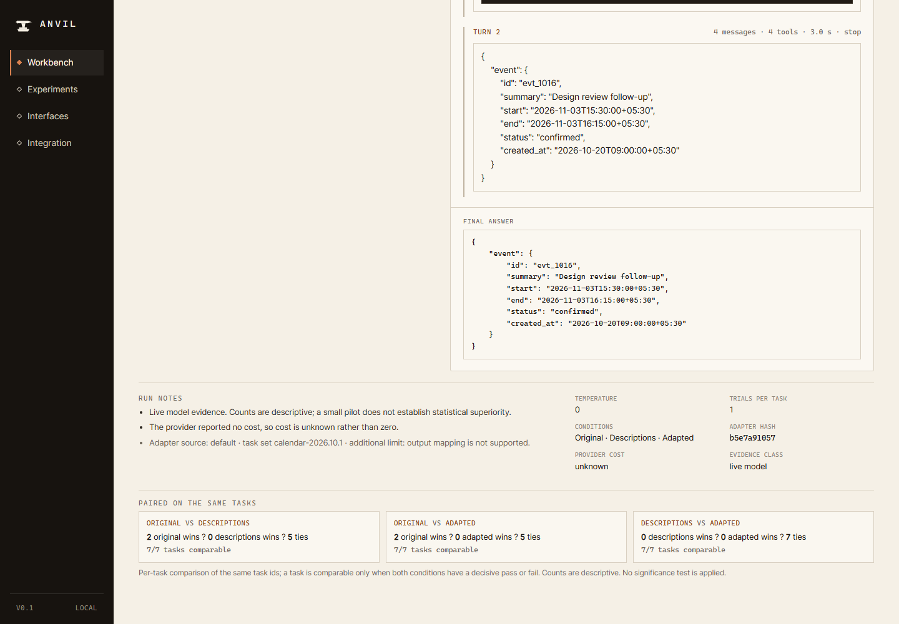

# Anvil

**Make MCP tools easier for models to call, and prove it.**

Agents fail on tool interfaces more often than on reasoning. They nest a field one level too deep, guess an id they never looked up, ask for 100 results from a tool that allows 50, invent a query syntax, get back an empty list, and report success. Then they drown in a 40,000-character API response.

Anvil fixes that at the interface, without touching the server, and measures whether the fix helped:

| | |
| --- | --- |
| **`anvil init`** | Point it at any MCP server. It lints the tools, scaffolds an adapter, states hidden limits, and writes a ready proxy config and starter tasks. |
| **`anvil proxy`** | Sits in front of the real server and serves adapted, filtered, re-described and output-trimmed tools to any MCP client. Every call is compiled back into the original call, validated and logged. |
| **`anvil eval`** | Runs your tasks through the raw and the adapted interface with your model, on a fresh server per trial, and grades what actually happened upstream, not what the model said. |
| **`anvil report`** | Turns real usage into which tools fail, where, and which return too much. |
| **`anvil inspect` / `scaffold`** | The lint and the adapter generator on their own, for CI and hand-tuning. |

Works with any MCP client (Claude Code, Claude Desktop, Cursor, VS Code, Windsurf, Codex, …), any MCP server (stdio or Streamable HTTP), and any OpenAI-compatible model or Ollama for evals. MIT licensed.

**▶ Replay of every recorded eval run:** <https://anvil-two-opal.vercel.app>

## Try it in one minute

Nothing to install or clone (`anvil` below is `npx -y -p github:Wali05/anvil anvil`). Lint the built-in issue tracker, with no server to reach and no model:

```bash
anvil inspect --domain issues
```

```text
Score 87/100 · 4 tools · ~559 catalog tokens · 0 errors, 4 warnings, 2 notes

 76  issues_search  (3 params, depth 1, ~97 tokens)
     ▲ q: "q" takes a free-text query. Models invent syntax the server does not support, then trust an empty result.
         fix: Expose structured filter fields and assemble the query string in an adapted tool (bounded query assembly).
     ▲ limit: "limit" has maximum 50, but the description does not say so. Models routinely ask for more and get a validation error.
         fix: State the limit in the description, or set a default in an adapted tool.
```

Those two findings are exactly why `gpt-oss-20b` failed this task in 3 of 3 attempts in our eval ([the trace](#the-failure-step-by-step)).

The `--sample` flag gives every command a deliberately awkward demo server (a ticket desk with nested envelopes, `O`/`C` status codes and cancel-by-opaque-id) plus the adapter that fixes it:

```bash
anvil proxy --sample --dry-run                    # what a model would see, adapted
anvil eval --sample --check                       # the demo tasks, validated without a model
anvil eval --sample --model qwen2.5:7b            # original vs adapted on your model (local Ollama here)
```

## Fix your own server

```bash
anvil init -- <your MCP server command>
anvil init --url https://example.com/mcp --header 'Authorization: Bearer ${TOKEN}'
```

On the built-in issue tracker (`anvil init -- npx -y -p github:Wali05/anvil anvil-mcp --domain issues --condition original`):

```text
Wrote anvil/anvil.proxy.json, anvil/inspect.txt, anvil/tasks.json, anvil/adapter.json
  adapter: 3 tool(s) flattened (issues_create, issues_update, issues_comment)
  descriptions: stated hidden limits on issues_search
  findings: anvil/inspect.txt (fix what the adapter doesn't)

Next:
  1. Review anvil/adapter.json and anvil/anvil.proxy.json …
  2. Check the catalog the model will see:  anvil proxy --config anvil/anvil.proxy.json --dry-run
  3. Write real tasks in anvil/tasks.json, then:  anvil eval … --check
  4. Use it from your client:  claude mcp add … -- npx -y -p github:Wali05/anvil anvil proxy --config /abs/anvil/anvil.proxy.json
  5. After real use:  anvil report anvil/calls.jsonl
```

The scaffold is a starting point. The adapter features that help most are the ones you add where `inspect.txt` points:

| What trips the model | What the adapter does |
| --- | --- |
| Nested objects (`event.start.dateTime`) | Flat fields mapped to dot paths (what `scaffold` generates) |
| Needs an id it doesn't have | **Lookup**: one read-only search, exactly one exact match, and the id is bound in. Zero or several matches mean nothing is written and the candidates go back to the model |
| Invents query syntax | Structured filter fields, assembled into the query string |
| RFC 3339 with offsets | Local time → ISO with a declared offset; date → day bounds; start + duration → end |
| Cryptic enum values | `valueMap` (`"high"` → `"P1"`) |
| Values it shouldn't have to choose | `const` and `default` |
| A 200-field result | **Output shape**: `pick` the fields that matter (`items[].title`), `maxItems`, `maxChars`. The model is told what was cut |

Adapters are plain JSON, never code: no `eval`, shell or generated JavaScript. One public call makes at most one lookup plus one target call, and every compiled call is validated against the original schema before it's sent. Passthrough tools can be filtered (`--include`, `--exclude`), renamed, re-described and output-shaped without an adapter. Secrets stay in the environment as `${VAR}`.

Guides: [docs/PROXY.md](docs/PROXY.md) (init, inspect, scaffold, proxy, report, output shaping), [docs/ADAPTER_SPEC.md](docs/ADAPTER_SPEC.md), [docs/TASKS.md](docs/TASKS.md) (eval).

## Prove it on your own server

An adapter is a hypothesis. `anvil eval` tests it with the same tasks, model, prompt and budgets across three conditions: **original** (the same capabilities through the raw tools), **descriptions** (only your description fixes) and **adapted** (the full proxy config).

```bash
anvil eval --config anvil/anvil.proxy.json --tasks anvil/tasks.json --model openai/gpt-oss-20b \
  --base-url https://openrouter.ai/api/v1 --attempts 3        # key in ANVIL_MODEL_API_KEY
```

Checks name the upstream's **original** tools, so one task file is fair to every condition. When the model calls the adapted `cancel_ticket(title)`, the check sees the `desk_cancel_ticket(ticket_id: "T-1003")` it compiled into:

```json
{ "id": "cancel-by-title",
  "prompt": "Cancel the ticket titled \"Unique billing glitch\" in the acme workspace.",
  "checks": [
    { "kind": "called", "tool": "desk_cancel_ticket", "args": { "ticket_id": "T-1003" }, "times": 1 },
    { "kind": "state", "call": { "tool": "desk_list_tickets", "args": { "query": { "workspace": "acme", "status": "O" } } }, "path": "items", "count": 2 } ] }
```

```text
                      original      adapted
passed                2/4           4/4
pass rate             50%           100%

Per task (passes)
  cancel-by-title     0/2           2/2             ▲
  count-open          2/2           2/2

Why trials did not pass
  cancel-by-title · original #1: fail — 1 of 3 check(s) failed.
      ✖ desk_cancel_ticket called with {"ticket_id":"T-1003"} exactly 1×: 0 matching successful call(s) of 1;
        inputs were {"workspace":"acme","ticket_id":"T-1001"}.
```

(Output from a scripted stand-in model that, like real models, guesses the id when it only has the raw interface. The test suite runs the same scenario. Run it with your own model.)

Each stdio trial gets a fresh server, so writes never leak between trials. A trial that runs out of turns, tool calls or time is `invalid`, not a pass or a fail. `--check` flags tasks that would pass with nothing done. The full record of every turn, call and check is saved as JSON.

## Add it to your MCP client

The proxy is an ordinary stdio MCP server. `anvil init` prints the Claude Code line for your config; the shapes for each client are below, shown with the built-in calendar fixture (a disposable local calendar, no account touched).

**Claude Code**

```bash
claude mcp add anvil-calendar -- npx -y -p github:Wali05/anvil anvil-mcp --domain calendar
```

**Claude Desktop, Cursor, Windsurf** (`claude_desktop_config.json`, `.cursor/mcp.json`, `~/.codeium/windsurf/mcp_config.json`):

```json
{
  "mcpServers": {
    "anvil-calendar": {
      "command": "npx",
      "args": ["-y", "-p", "github:Wali05/anvil", "anvil-mcp", "--domain", "calendar"]
    }
  }
}
```

**VS Code** (`.vscode/mcp.json`):

```json
{
  "servers": {
    "anvil-calendar": { "type": "stdio", "command": "npx", "args": ["-y", "-p", "github:Wali05/anvil", "anvil-mcp", "--domain", "calendar"] }
  }
}
```

**Codex CLI** (`~/.codex/config.toml`):

```toml
[mcp_servers.anvil-calendar]
command = "npx"
args = ["-y", "-p", "github:Wali05/anvil", "anvil-mcp", "--domain", "calendar"]
```

For your own server, swap the args for `anvil proxy --config /abs/path/anvil.proxy.json`. On Windows, use `"command": "cmd"` and put `"/c", "npx"` in front of the args. The first start takes about 30 s while npm installs and builds the package. Clients that want a URL: add `--http 8808` and connect to `http://127.0.0.1:8808/mcp` (loopback only unless `ANVIL_HTTP_TOKEN` is set). The dashboard's **Integration** tab generates all of these. An agent skill in [`skills/anvil/SKILL.md`](skills/anvil/SKILL.md) teaches an agent when and how to use Anvil.

## The workbench and the recorded results

Anvil started as a workbench for the question "does changing a tool interface help this model?", run on two built-in fixtures (a calendar and an issue tracker) with server-side validators. `anvil eval` brings the same method to any server; the workbench keeps the curated fixtures, a dashboard, and a sealed task set.

Tasks passed on the sealed eval v2 split (15 tasks written after the dev failures were studied, hashes frozen before any run):

| Model | Original tools | Better descriptions | Anvil adapter |
| --- | --- | --- | --- |
| `openai/gpt-oss-20b` | 20/45 | 34/45 | **43/45** |
| `deepseek-v4.1-flash` | 43/45 | 45/45 | 45/45 |
| `nvidia/nemotron-3-ultra` | 15/15 | 15/15 | 15/15 |

Synthetic fixtures, 3 attempts per task (Nemotron 1), temperature 0. The smaller model gains the most; the strong models are already near the ceiling. Descriptions alone close a good part of the gap, which is why they are their own condition. There is one regression against descriptions, and the sample is small. Run IDs, per-task pairs and the earlier `qwen2.5:7b` pilot are in [docs/EVALUATION.md](docs/EVALUATION.md).



### The failure, step by step

`openai/gpt-oss-20b`, task `iss-e2-query-priority-label`, original tools, the same in 3 of 3 attempts:

1. Task: list the open P2 bugs in the `acme/orbit` repo.
2. The model calls `issues_search` with `limit: 100`, which is rejected because the maximum is 50.
3. It retries with `q: "status:open priority:P2 label:bug"`, a query dialect the tool doesn't support, and gets 0 results.
4. It answers `{"issue_numbers": []}`. The correct answer is `[7, 9, 12, 22]`.

Nothing was written, so a state-only check would call this fine. The answer-contract check fails it. The adapted `search_issues` takes `status`, `priority` and `label` as enum fields and builds the query itself; `anvil init` would have added "`limit` is at most 50" to the description.

### Run the dashboard

Requirements: Node.js 20.11+.

```bash
git clone https://github.com/Wali05/anvil && cd anvil
npm ci
npm run build
npm start            # dashboard + API on http://127.0.0.1:4317
```

**Explore a simulation** exercises the interfaces, compiler and validators with a scripted policy and needs no model or key. Simulations are labelled and never counted as results. For live runs, configure any OpenAI-compatible endpoint (OpenRouter, Together, Groq, vLLM, LM Studio, a hosted provider) or a local Ollama model. The **Interfaces** tab edits adapters with live validation and compile previews.

| Variable | Meaning |
| --- | --- |
| `ANVIL_MODEL_PROVIDER` | `ollama` (default) or `openai-compatible` |
| `ANVIL_MODEL_BASE_URL` | e.g. `http://127.0.0.1:11434/v1` |
| `ANVIL_MODEL` | model id |
| `ANVIL_MODEL_API_KEY` | key for hosted endpoints (read from the environment only; never written to disk, run records or exports) |
| `ANVIL_MIN_REQUEST_INTERVAL_MS` | spacing between requests for rate-limited providers |
| `ANVIL_DATA_DIR` | where run JSON is written (default `.anvil`) |
| `ANVIL_HTTP_TOKEN` | bearer token required when serving MCP over HTTP on a non-loopback host |

```bash
npm run seal:check
npm run live -- calendar eval2 all 1     # domain, split, tasks (or all), attempts per task
```

## CLI

```text
anvil init      lint + adapter + config + starter tasks       <server> [--dir anvil]
anvil proxy     serve adapted/filtered/shaped tools           <server> [--adapter] [--include] [--exclude] [--log-file] [--http <port>] [--dry-run]
anvil eval      original vs adapted on your model             <server> --tasks tasks.json --model <id> [--attempts N] [--check]
anvil report    summarize a proxy call log                    <calls.jsonl>
anvil inspect   lint a tool catalog                           <server> | --tools-file | --domain  [--json] [--fail-on warn]
anvil scaffold  write a starter adapter                       <server> [--tools a,b] --out adapter.json
anvil serve     workbench dashboard + API                     [--port 4317]
anvil mcp       a built-in fixture server                     --domain calendar|issues [--condition …] [--http <port>]
anvil workbench-mcp | export | check-mcp
```

`<server>` is `-- <command> [args…]`, `--url <url> [--header …]`, `--config anvil.proxy.json` or `--sample`. `anvil --help` has every flag. The older `anvil-mcp-proxy` entry point (`--upstream-command`, `--upstream-arg`, `--adapter-file`, `--sample`) runs on the same engine.

Checks: `npm run typecheck`, `npm test`, `npm run smoke:mcp`, `npm run smoke:proxy`, `npm run smoke:api`, `npm run check:sim`, `npm run e2e`, `npm run build:static`.

## Architecture

```text
src/proxy/     upstream client (stdio + HTTP), schema normalization, catalog, executor, output shaping,
               inspect, scaffold, init, report, CLI, the sample-desk locator
src/eval/      tasks format, checks, the eval runner and its report
src/core/      adapter schema + compiler + lookup, interfaces, model transport, workbench runner, metrics, store
src/domains/   calendar + issue-tracker fixtures, raw tools, validators, tasks, frozen adapters
src/mcp/       MCP serving (stdio + Streamable HTTP), fixture and sample servers, workbench server, client snippets
src/server/    Express API, SSE progress
web/           React/Vite dashboard (also builds the static replay)
examples/      proxy configs, adapters, sample tasks
skills/        agent skill
docs/          guides, evaluation, evidence runs, screenshots
```

## Related work

Rewriting tool interfaces isn't new, and Anvil doesn't claim to have invented it:

- **Proxies and gateways that rename and re-describe tools:** FastMCP's tool transformation (rename, hide or default arguments), [mcp-transform-proxy](https://github.com/bbrowning/mcp-transform-proxy), and the WSO2 AI gateway's MCP rewrite policy.
- **Description and prompt optimization:** toolfit, DSPy / GEPA, Karenina.

Anvil's angle is the combination: a linter that names the failure patterns, declarative adapters that go beyond renames (flattening, lookups that replace ids, query assembly, time transforms, output trimming) while staying bounded and reviewable, a proxy that drops into any client with `npx`, and an eval that grades every condition by what happened on the server. You can tell whether the change helped, or whether better descriptions alone would have done it.

## Limits

- **Bounded adapters.** One public call makes at most one lookup plus one target call. Outputs can be trimmed but not renamed or restructured.
- **Tools only.** The proxy forwards tools, not the upstream's resources or prompts.
- **Mappable fields.** Mapping paths must be identifiers; fields named like `a-b` pass through but can't be adapted.
- **Lookups need annotations.** A lookup only calls upstream tools annotated `readOnlyHint: true`.
- **Eval resets need stdio.** A fresh server per trial works for stdio servers whose state is in memory or in a scratch location on their command line; HTTP servers aren't reset, so keep their tasks read-only or point them at a disposable environment.
- **Small samples mislead.** The recorded results are 15 synthetic tasks with 1–3 attempts each, a pilot rather than a benchmark. Your own evals deserve the same caution: add tasks before attempts, and keep a held-out set.
- **Heuristic lint.** `inspect` rules are name- and schema-based heuristics; a high score is not a guarantee.

## License

MIT. See [`LICENSE`](LICENSE).
