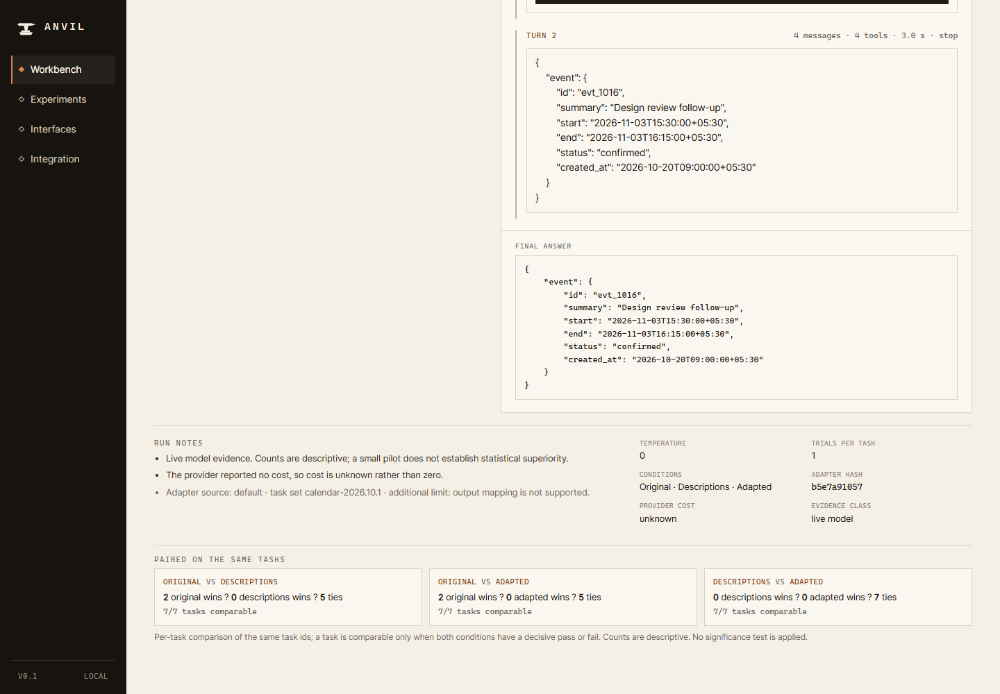

# Anvil

**Make MCP tools easier for models to call, and prove it.**

Agents fail on tool interfaces more often than on reasoning. They nest a field one level too deep, guess an id they never looked up, ask for 100 results from a tool that allows 50, invent a query syntax, get back an empty list, and report success.

Anvil fixes that at the interface, without touching the server:

- **`anvil inspect`** lints any MCP server's tool catalog for the patterns that make models fail, with a concrete fix for each.
- **`anvil scaffold`** writes a validated starter adapter that flattens nested inputs.
- **`anvil proxy`** sits in front of the real server and serves adapted, filtered and re-described tools to any MCP client. Every call is compiled back into the original call, validated, and logged.
- **`anvil report`** turns the proxy's call log into "which tools fail, where, and why".
- **The workbench** measures whether an interface change actually helps a given model: the same tasks under original, better-described and adapted tools, with the end state checked independently.

Works with any MCP client (Claude Code, Claude Desktop, Cursor, VS Code, Windsurf, Codex, …), any MCP server (stdio or Streamable HTTP), and any OpenAI-compatible model for evals. MIT licensed.

**▶ Replay of every recorded eval run:** <https://anvil-two-opal.vercel.app>

## Try it in one minute

Nothing to install or clone. Lint the built-in issue-tracker fixture (no network to a server, no model):

```bash
npx -y -p github:Wali05/anvil anvil inspect --domain issues
```

```text
Score 87/100 · 4 tools · ~559 catalog tokens · 0 errors, 4 warnings, 2 notes

 76  issues_search  (3 params, depth 1, ~97 tokens)
     ▲ q: "q" takes a free-text query. Models invent syntax the server does not support, then trust an empty result.
         fix: Expose structured filter fields and assemble the query string in an adapted tool (bounded query assembly).
     ▲ limit: "limit" has maximum 50, but the description does not say so. Models routinely ask for more and get a validation error.
         fix: State the limit in the description, or set a default in an adapted tool.
```

Those two findings are exactly why `gpt-oss-20b` failed this task in 3 of 3 attempts in our eval (details [below](#the-failure-step-by-step)). Now point it at a server you use:

```bash
npx -y -p github:Wali05/anvil anvil inspect -- npx -y @modelcontextprotocol/server-filesystem ~/Documents
npx -y -p github:Wali05/anvil anvil inspect --url https://example.com/mcp --header 'Authorization: Bearer ${TOKEN}'
```

## Put Anvil in front of your MCP server

```bash
# 1. Find what trips models up
anvil inspect -- <your server command>

# 2. Generate a starter adapter for the nested tools, then edit it
anvil scaffold --out adapter.json -- <your server command>

# 3. Serve the adapted tools; check the exposed catalog first with --dry-run
anvil proxy --adapter adapter.json --log-file calls.jsonl -- <your server command>

# 4. After some real use, see which tools still fail and why
anvil report calls.jsonl
```

(`anvil` here is `npx -y -p github:Wali05/anvil anvil`, or `node dist/cli.js` in a checkout.)

What the proxy does with the upstream's tools:

- **Adapted tools** come from the adapter and are validated against the live upstream schemas at start-up. Each call is checked against the friendly schema, compiled into the original call, checked against the original schema, and sent. They replace the originals they call, so the model isn't offered both.
- **Everything else passes through** unchanged, optionally filtered (`--include`, `--exclude`, `*` globs) and renamed or re-described (`tools.overrides`). An adapter is optional: a proxy config alone can give you, say, a read-only view of a filesystem server with clearer descriptions.
- **Results come back verbatim** (`content`, `structuredContent`, `isError`).
- **Secrets stay in the environment**: `${VAR}` in headers, env, args or URL is read at start-up and never logged.

A config file keeps it reviewable ([`examples/`](examples/) has runnable ones):

```json
{
  "schema": "anvil.proxy/v1",
  "name": "files-readonly",
  "upstream": { "command": "npx", "args": ["-y", "@modelcontextprotocol/server-filesystem", "${HOME}/Documents"] },
  "tools": {
    "exclude": ["write_file", "edit_file", "move_file", "create_directory"],
    "overrides": { "search_files": { "description": "Find files whose names match a glob. Call list_allowed_directories first." } }
  },
  "log": { "file": "./files-calls.jsonl" }
}
```

Full reference: [docs/PROXY.md](docs/PROXY.md) (commands, config, inspect rules, HTTP serving) and [docs/ADAPTER_SPEC.md](docs/ADAPTER_SPEC.md) (mappings, transforms, lookups).

### What an adapter can do

An adapter is plain JSON, no code. Each public tool maps its inputs onto one original call:

| Problem the model has | Adapter feature |
| --- | --- |
| Nested objects (`event.start.dateTime`) | Flat fields mapped to dot paths (what `scaffold` generates) |
| Needs an id it doesn't have | **Lookup**: one read-only search, exactly one exact match, the id is bound in. Zero or several matches → nothing is written, the candidates are returned |
| Invents query syntax | Structured filter fields assembled into the query string |
| RFC 3339 with offsets | Local time → ISO with a declared offset; date → day bounds; start + duration → end |
| Cryptic enum values | `valueMap` (`"high"` → `"P1"`) |
| Values it shouldn't choose | `const` and `default` |
| `[{ "email": … }]` wrappers | `wrapEmail` |

Hard limits by design: at most one lookup plus one target call per public call, inputs only (outputs are returned unchanged), no `eval`, shell or generated code.

## Add it to your MCP client

The proxy and the fixture servers are ordinary stdio MCP servers. To try the adapted calendar fixture (a disposable local calendar, no account touched):

**Claude Code**

```bash
claude mcp add anvil-calendar -- npx -y -p github:Wali05/anvil anvil-mcp --domain calendar
```

**Claude Desktop, Cursor, Windsurf** (`claude_desktop_config.json`, `.cursor/mcp.json`, `~/.codeium/windsurf/mcp_config.json`):

```json
{
  "mcpServers": {
    "anvil-calendar": {
      "command": "npx",
      "args": ["-y", "-p", "github:Wali05/anvil", "anvil-mcp", "--domain", "calendar"]
    }
  }
}
```

**VS Code** (`.vscode/mcp.json`):

```json
{
  "servers": {
    "anvil-calendar": { "type": "stdio", "command": "npx", "args": ["-y", "-p", "github:Wali05/anvil", "anvil-mcp", "--domain", "calendar"] }
  }
}
```

**Codex CLI** (`~/.codex/config.toml`):

```toml
[mcp_servers.anvil-calendar]
command = "npx"
args = ["-y", "-p", "github:Wali05/anvil", "anvil-mcp", "--domain", "calendar"]
```

On Windows, use `"command": "cmd"` and put `"/c", "npx"` in front of the args. The first start takes about 30 s while npm installs and builds the package. Use `--domain issues` for the issue tracker. For your own server, swap the args for `anvil proxy --config /abs/path/anvil.proxy.json`. Clients that want a URL instead: add `--http 8808` and connect to `http://127.0.0.1:8808/mcp` (loopback only unless `ANVIL_HTTP_TOKEN` is set). The dashboard's **Integration** tab generates all of these for you.

There's also an agent skill in [`skills/anvil/SKILL.md`](skills/anvil/SKILL.md) that teaches an agent when and how to use these commands.

## Does it help? The eval

Interface changes are easy to make and hard to verify, so Anvil ships the measurement too. Every task runs three ways with the same model, prompt, fixture reset, temperature and budgets:

| Condition | What the model sees |
| --- | --- |
| **Original** | The raw tools: nested schemas, strict query syntax, terse errors. |
| **Descriptions** | The same tools and schemas with better documentation only. |
| **Adapted** | Tools from an adapter, each call compiled back into the original call. |

Independent validators then inspect the final state and the answer: exact fields on the target record, no extra writes, unrelated records unchanged byte for byte, and the exact answer for queries. A trial is `pass`, `fail` or `invalid` (no verdict, e.g. the budget ran out). "The model said done" never counts.

Tasks passed on the sealed eval v2 split (15 tasks written after the dev failures were studied, hashes frozen before any run):

| Model | Original tools | Better descriptions | Anvil adapter |
| --- | --- | --- | --- |
| `openai/gpt-oss-20b` | 20/45 | 34/45 | **43/45** |
| `deepseek-v4.1-flash` | 43/45 | 45/45 | 45/45 |
| `nvidia/nemotron-3-ultra` | 15/15 | 15/15 | 15/15 |

Synthetic fixtures, 3 attempts per task (Nemotron 1), temperature 0. The smaller model gains the most; the strong models are already near the ceiling. Descriptions alone close a good part of the gap, which is why they are their own condition. There is one regression against descriptions, and the sample is small. All of it, with run IDs, per-task pairs and the earlier `qwen2.5:7b` pilot, is in [docs/EVALUATION.md](docs/EVALUATION.md).



### The failure, step by step

`openai/gpt-oss-20b`, task `iss-e2-query-priority-label`, original tools, the same in 3 of 3 attempts:

1. Task: list the open P2 bugs in the `acme/orbit` repo.
2. The model calls `issues_search` with `limit: 100`, which is rejected because the maximum is 50.
3. It retries with `q: "status:open priority:P2 label:bug"`, a query dialect the tool doesn't support, and gets 0 results.
4. It answers `{"issue_numbers": []}`. The correct answer is `[7, 9, 12, 22]`.

Nothing was written, so a state-only check would call this fine. The answer-contract check fails it. The adapted `search_issues` takes `status`, `priority` and `label` as enum fields and builds the query itself.

## Run the workbench

Requirements: Node.js 20.11+.

```bash
git clone https://github.com/Wali05/anvil && cd anvil
npm ci
npm run build
npm start            # dashboard + API on http://127.0.0.1:4317
```

**Explore a simulation** exercises the real interfaces, compiler and validators with a scripted policy and needs no model or key; simulations are labelled and never counted as results. To run live, configure any OpenAI-compatible endpoint in the dashboard (OpenRouter, Together, Groq, vLLM, LM Studio, a hosted provider) or a local Ollama model. The **Interfaces** tab edits adapters with live validation and compile previews.

From the command line:

| Variable | Meaning |
| --- | --- |
| `ANVIL_MODEL_PROVIDER` | `ollama` (default) or `openai-compatible` |
| `ANVIL_MODEL_BASE_URL` | e.g. `http://127.0.0.1:11434/v1` |
| `ANVIL_MODEL` | model id |
| `ANVIL_MODEL_API_KEY` | key for hosted endpoints (read from the environment only; never written to disk, run records or exports) |
| `ANVIL_MIN_REQUEST_INTERVAL_MS` | spacing between requests for rate-limited providers |
| `ANVIL_DATA_DIR` | where run JSON is written (default `.anvil`) |

```bash
npm run seal:check
npm run live -- calendar eval2 all 1     # domain, split, tasks (or all), attempts per task
```

Budgets per trial (turns, underlying tool calls, wall clock) and per run (tool calls, tokens) are enforced; the run token cap stops the run before any further model request once it is spent.

## CLI

```text
anvil inspect   lint a tool catalog          (--url | -- <cmd> | --tools-file | --domain) [--json] [--fail-on warn]
anvil scaffold  write a starter adapter      (--url | -- <cmd> | --tools-file | --domain) [--tools a,b] --out adapter.json
anvil proxy     serve adapted/filtered tools (--url | -- <cmd> | --config) [--adapter] [--include] [--exclude] [--log-file] [--http <port>] [--dry-run]
anvil report    summarize a proxy call log   <calls.jsonl> [--json]
anvil serve     workbench dashboard + API    [--port 4317]
anvil mcp       a built-in fixture server    --domain calendar|issues [--condition adapted|original|descriptions] [--http <port>]
anvil workbench-mcp   the workbench as MCP tools (validate adapters, preview mappings, run bounded experiments)
anvil export    an adapter bundle            --domain calendar|issues [--kind bundle|spec|mcp-config]
```

`anvil --help` has every flag. Checks: `npm run typecheck`, `npm test`, `npm run smoke:mcp`, `npm run smoke:api`, `npm run check:sim`, `npm run e2e`, `npm run build:static`.

## Architecture

```text
src/proxy/     upstream client (stdio + HTTP), schema normalization, catalog, async executor, inspect, scaffold, report
src/core/      adapter schema + compiler + lookup, interfaces, model transport, runner, metrics, JSON store
src/domains/   calendar + issue-tracker fixtures, raw tools, validators, tasks, frozen adapters
src/mcp/       MCP serving (stdio + Streamable HTTP), fixture server, workbench server, client snippets, export
src/server/    Express API, SSE progress
web/           React/Vite dashboard (also builds the static replay)
examples/      proxy configs and adapters
skills/        agent skill
docs/          proxy guide, adapter spec, evaluation, evidence runs, screenshots
```

## Related work

Rewriting tool interfaces isn't new, and Anvil doesn't claim to have invented it:

- **Proxies and gateways that rename and re-describe tools:** FastMCP's tool transformation (rename, hide or default arguments), [mcp-transform-proxy](https://github.com/bbrowning/mcp-transform-proxy), and the WSO2 AI gateway's MCP rewrite policy.
- **Description and prompt optimization:** toolfit, DSPy / GEPA, Karenina.

Anvil's angle is the combination: a linter that names the failure patterns, adapters that go beyond renames (flattening, lookups that replace ids, query assembly, time transforms) while staying declarative and bounded, a Node proxy that drops into any client with `npx`, and a three-condition experiment with independently checked end state, so you can tell whether the change helped or the descriptions alone would have done it.

## Limits

- **Inputs only.** Adapters don't reshape outputs, and one public call makes at most one lookup plus one target call.
- **Tools only.** The proxy forwards tools, not the upstream's resources or prompts.
- **Mappable fields.** Mapping paths must be identifiers; fields named like `a-b` pass through but can't be adapted.
- **Lookups need annotations.** A lookup only calls upstream tools annotated `readOnlyHint: true`.
- **Small, synthetic evals.** 15 sealed tasks with 1–3 attempts each, on local fixtures rather than live services. Treat the numbers as a pilot, not a benchmark. Evals don't run against proxied servers yet: you can log and report real usage, but measured before/after comparisons need fixture tasks with validators.
- **Heuristic lint.** `inspect` rules are name- and schema-based heuristics; a high score is not a guarantee.

## License

MIT. See [`LICENSE`](LICENSE).
